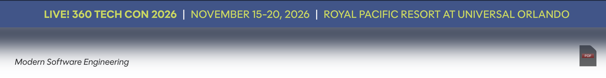

# AIM01: Workshop: Hitchhiker's Guide to Building an AI Solution Now

- **Date:** Monday, November 16, 2026
- **Time:** 8:30am–5:30pm ET
- **Co-presenter:** Matt Nunn
- **Abstract:** <https://live360events.com/events/orlando-2026/sessions/monday/aim01-wksp-building-ai.aspx>

## Slides

All slides will be available on the conference web site by the end of the week. Please visit the individual session abstract page and look for the PDF symbol.

## Demos and References

- [Azure-Samples/azure-sql-db-ai-samples-search](https://github.com/Azure-Samples/azure-sql-db-ai-samples-search)

> More demos and references are coming soon.
