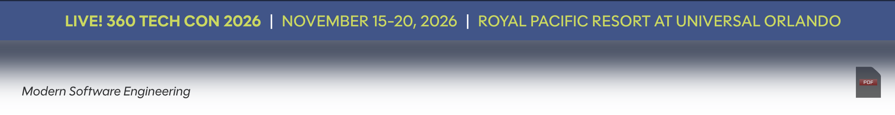

# VST13: Agentic DevOps with GitHub and Azure DevOps: What Actually Works in 2026

- **Date:** Tuesday, November 17, 2026
- **Time:** 3:00pm–4:15pm ET
- **Abstract:** <https://live360events.com/events/orlando-2026/sessions/tuesday/vst13-agentic-devops.aspx>

## Slides

All slides will be available on the conference web site by the end of the week. Please visit the individual session abstract page and look for the PDF symbol.

## Demos and References

> Demos and references are coming soon.

## License

Slides are hosted on the Live! 360 site and licensed CC BY 4.0, as noted in the deck; code in this repo is MIT. See [LICENSE](../LICENSE).
